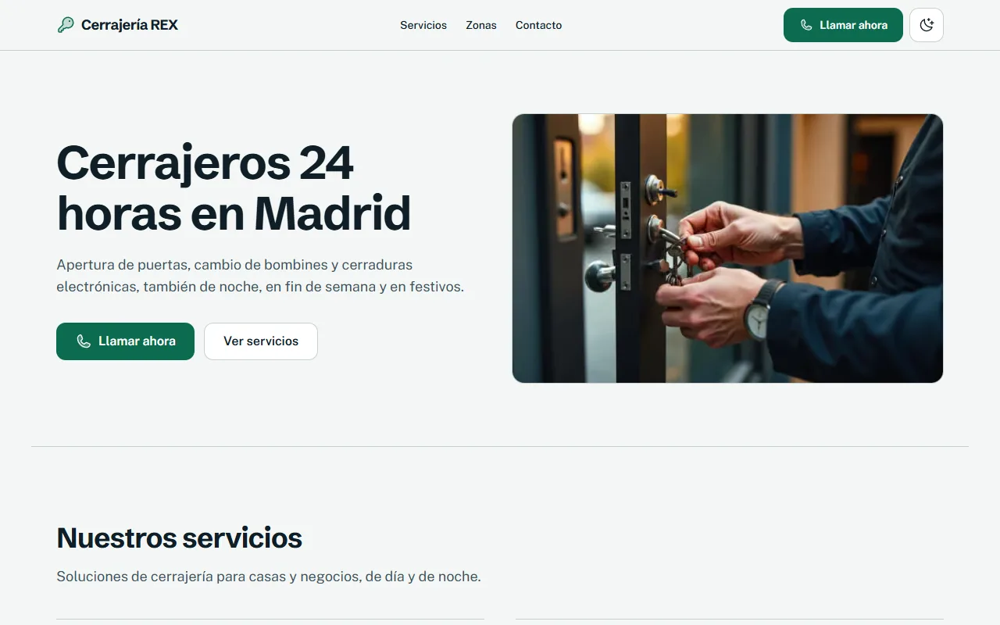
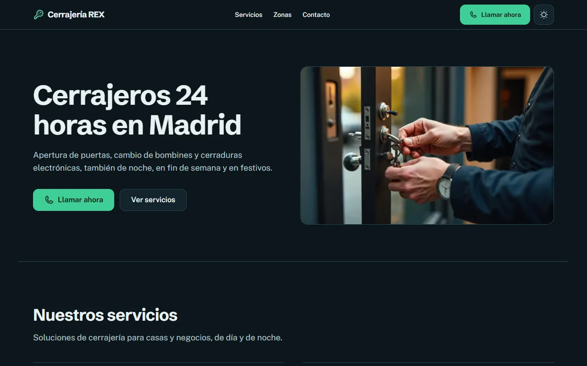
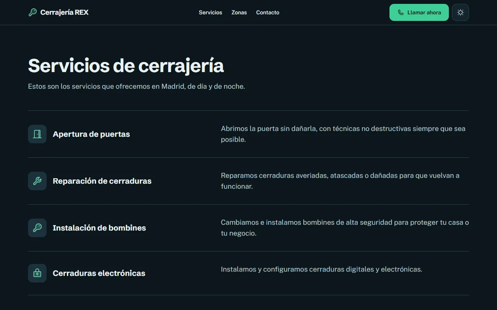
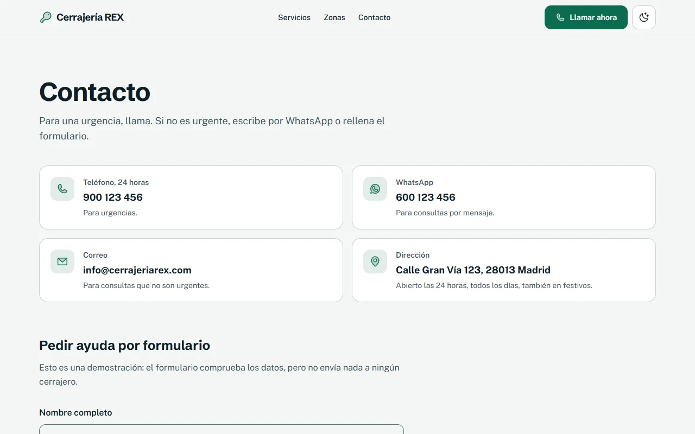
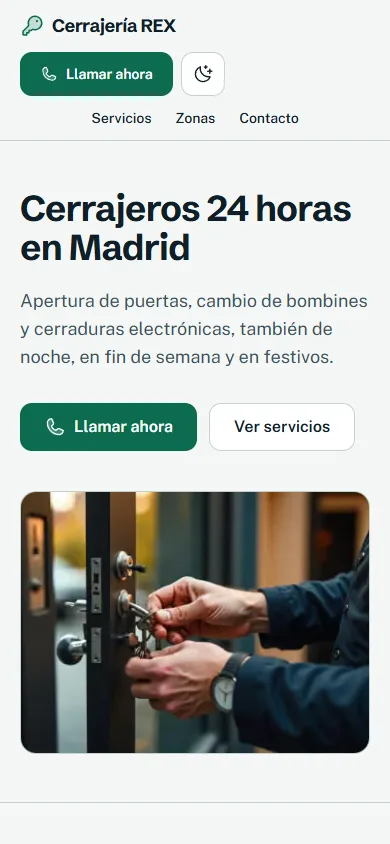

# Cerrajería REX: web

> Spanish version: [README.es.md](README.es.md)

A landing page for a 24-hour locksmith in Madrid: services, coverage by district, contact channels and a quote request form. It is a **demonstration project, not a real business**. Nothing is sent to anyone, and the contact details are placeholders from an earlier prototype (see [Known limitations](#known-limitations)).

This is not deployed. Run it locally with the steps in [Run it](#run-it).

| Home (light) | Home (dark) | Services (dark) |
|---|---|---|
|  |  |  |

| Contact (light) | Home on mobile (light) | Contact on mobile (dark) |
|---|---|---|
|  |  |  |

## What it demonstrates

- **One validation schema, two places.** The quote form and the API both use the same zod schema (`src/lib/schemas.ts`). The schema is strict: an unknown field is a 400, not silently dropped, and a honeypot field must arrive empty.
- **Contact links that cannot be malformed.** `tel:`, WhatsApp and `mailto:` links are built by pure functions that throw on bad input (`src/lib/links.ts`). A typo in a phone number fails the build's tests instead of shipping a dead link.
- **Honest structured data.** The `Locksmith` JSON-LD contains only what the site states: name, area, contact and 24-hour opening. There are no ratings, prices or years of activity, because the source material did not have them, and a test fails if one appears.
- **Content as typed data.** Services, districts, copy and the demo notice live in `src/content`. A test scans every published file for em or en dashes and for claims that cannot be verified (years of experience, certifications, response times).
- **Logic separated from UI.** Pure functions in `src/lib`, state in `src/hooks`, presentation in `src/components`. Only `src/lib/api.ts` calls `fetch`.
- **Accessibility as a test, not a claim.** axe runs over every public page in both themes, on desktop and on mobile, with WCAG 2.1 AA and best-practice rules, and the suite fails on any violation. Error states of the form are audited too.
- **Demonstration behaviour is explicit.** The API answers every valid request with a clear demo message and stores nothing. The notice page and the footer say so.

## Quality

| What | How | Count |
|---|---|---|
| Unit, content and route tests | Vitest | 55 tests in 8 files |
| End-to-end, API contract and accessibility | Playwright + `@axe-core/playwright` | 52 tests: 38 on desktop, 14 on mobile (the mobile project runs only the accessibility spec) |
| Accessibility rules | axe, `wcag2a`, `wcag2aa`, `wcag21a`, `wcag21aa`, `best-practice` | 5 public pages plus 2 form states, in dark and light |
| Types | `tsc --noEmit`, `strict` + `noUncheckedIndexedAccess` | clean |
| Lint | ESLint 9, `next/core-web-vitals` and `typescript-eslint` | clean |

CI (`.github/workflows/ci.yml`) runs lint, typecheck, unit tests, build and the Playwright suite on every push and pull request to `main`.

### Measured performance

Lighthouse 12.8.2, mobile emulation with simulated throttling, production build served locally (`next start -p 3201`), median of 3 runs for each page.

| Page | Performance | Accessibility | Best practices | SEO | LCP | CLS | TBT |
|---|---|---|---|---|---|---|---|
| Home | 97 | 100 | 100 | 100 | 2.6 s | 0 | 86 ms |
| Services | 95 | 100 | 100 | 100 | 2.6 s | 0 | 142 ms |
| Contact | 96 | 100 | 100 | 100 | 2.3 s | 0 | 187 ms |

These are lab numbers on localhost. A deployed site behind a CDN will differ, and real-user data would say more than any of this. The LCP element is the hero photograph, served as WebP. The median LCP on home and services (2.6 s) is still above the 2.5 s "good" threshold, so the hero image is the first thing to optimise further.

## Architecture

```
src/
  app/          Routes only: pages, the quote API route, metadata, generated icon and share image
  components/   Presentation: props in, callbacks out (ui, layout, home, services, contact, seo)
  hooks/        State: use-theme, use-quote-form
  lib/          Pure logic: schemas, quotes, links, phone, rate limit, SEO data, theme, API client
  content/      Typed data: site, services, districts, home copy, notice, quote kinds
e2e/            Playwright: home and navigation, contact form, API contract, accessibility
scripts/        Image optimisation and README screenshots
```

## Decisions and trade-offs

| Decision | Choice | Trade-off |
|---|---|---|
| Quote requests | Validated, then acknowledged with a demo response. Nothing is emailed or stored | The form reaches nobody. The extension point is marked in `src/lib/quotes.ts` |
| Rate limiting | Sliding window in memory, 5 requests per 10 minutes per IP | Per instance, and it trusts `x-forwarded-for`, which a client can set. Fine for a demo, not for production |
| Theme | Follows the system by default; the user's choice is stored in `localStorage`. One theme per page | No server-side preference |
| Animation | CSS transitions only, all switched off under `prefers-reduced-motion` | No scroll choreography. The site is about getting to the phone number, not about motion |
| Maps | No embedded map. Coverage is a list of districts | No geographic precision. The earlier map was a generated image with unreadable labels, so it was dropped |
| Testimonials | Removed entirely | The earlier page used stock portraits and invented ratings. Real reviews need a real source |
| Images | WebP generated from originals kept out of git (`images-src/`) | The originals must be kept by whoever runs `pnpm images` |

## Known limitations

- **Contact details are placeholders.** The phone numbers (900 123 456 and 600 123 456), the email and the street address come from the earlier prototype. They look like placeholders and must be confirmed or replaced before anyone uses them.
- **The hero photograph has no documented origin.** It looks machine-generated. Treat it as unlicensed until the owner confirms where it came from.
- **No privacy policy.** The form collects a name, a phone number and an address. The demo does not store them, but a real service would need a privacy notice and a legal basis for processing.
- **Payment methods and service descriptions need owner confirmation.** They come from the earlier prototype.
- **Rate limiting is per instance** and not shared between serverless invocations.
- **Spanish only**, and prices are not shown because the site has none.

## Run it

```bash
pnpm install
cp .env.example .env.local   # optional: sets the public site URL used in SEO tags
pnpm dev                     # http://localhost:3201
```

| Script | What it does |
|---|---|
| `pnpm lint` / `pnpm typecheck` | ESLint / TypeScript |
| `pnpm test` | Vitest unit, content and route tests |
| `pnpm build && pnpm test:e2e` | Production build, then Playwright (starts `next start` on port 3201 itself) |
| `pnpm images` | Converts the originals in `images-src/` (not versioned) to WebP in `public/images/` |
| `pnpm screenshots` | Captures the README screenshots from a running `pnpm start` |

Set `PW_CHROMIUM_PATH` to use an already installed Chromium for the E2E suite; otherwise run `pnpm exec playwright install chromium` once.

## About this repository

This is a from-scratch rebuild of an earlier prototype. No code, styles or configuration were copied from it. Its copy and its hero photograph were reviewed and reused where they could be checked, and the rest was dropped or rewritten. The commit history is the real build history.

## License

The code is MIT licensed (see [LICENSE](LICENSE)). The photograph in `public/images` and the texts in `src/content` are **not** covered by that license.
